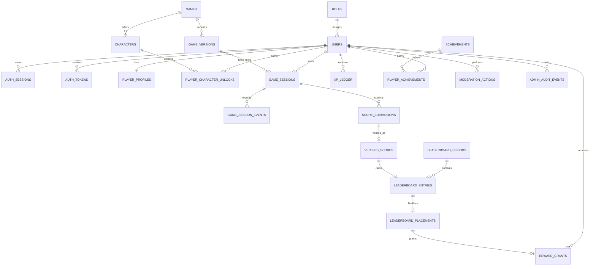

# PlayRush Release 1 data model

## Relationship overview

## Identity and access

`roles` supplies server-controlled role identities. `users` owns unique email, username, public UUID, credential hash, verification state, and account status. `auth_sessions` stores only refresh-token hashes, rotation families, expiry, revocation, and reuse markers. `auth_tokens` stores single-use verification/reset token hashes. Plain credentials or tokens have no schema location.

## Versioned game configuration

`games` points to an optional active immutable `game_versions` record. Each version owns a rules identifier, JSON scoring configuration, and duration cap. `characters` belong to a game and are constrained to cosmetic-only behavior with versioned unlock levels. Seeded Release 1 rules are one point per metre, ten points per coin, a five-minute cap, and cosmetic unlocks at levels 1, 3, and 5.

`progression_policy_versions` independently versions the approved progression formula: floor of validated score divided by 10 and level `1 + floor(total XP / 500)`. Keeping it separate prevents a later scoring change from silently reinterpreting historical progression.

## Gameplay integrity

`game_sessions` fixes the user, game version, server-issued seed/nonce hashes, lifecycle, start, and expiry. `game_session_events` stores ordered simulation input. `score_submissions` records non-authoritative claims, replay digests, and verification state. Only `verified_scores` stores authoritative metres, coins, computed score, server finish time, and disqualification state. Unique session/submission constraints reject duplicate accepted results.

M05 consumes `game_sessions` without a schema change. Raw 256-bit seed and nonce values are returned only from the creation use case; SHA-256 hashes occupy `seed_hash` and `nonce_hash`. Creation fixes the selected active published version and server UTC window. The application locks the active user row to enforce one open session per user/game/mode despite MySQL/MariaDB lacking portable partial unique indexes. `issued`, `active`, and `submitted` are treated as open; only issued/active rows age to expired automatically.

## Progression and competition

`xp_ledger` is append-only and globally idempotent. M04 locks the relevant `player_profiles` row, appends one ledger event, and updates the cached total/level in the same transaction. Policy version and resulting level are retained in ledger metadata for repeat-safe original-effect responses. Character unlocks, achievements, badges, and reward grants use separate uniqueness/idempotency keys and remain future milestone behavior.

`leaderboard_periods` owns UTC start/end/grace boundaries. A `leaderboard_entry` is unique per period/game/player and references one verified score. Its ranking index contains score, server finish time, and session UUID for deterministic ordering. Final top-10 results are frozen in `leaderboard_placements`. Versioned `leaderboard_reward_rules` preserve the approved virtual XP/badge amounts for places 1, 2, 3, and 4–10. `reward_grants` links the rule used, permits at most one reward type per period/player, and also has a global idempotency key.

## Administration and retention

`moderation_actions` links the administrator, player/session/score target, action, reason, and time. `admin_audit_events` is append-only through update/delete rejection triggers. XP corrections likewise require new ledger adjustments rather than mutation.

The schema supports soft deletion/status changes for accounts. Actual privacy retention periods, replay archival, and deletion/anonymization policy remain launch decisions. Foreign-key restrictions intentionally preserve ledger, score, moderation, and reward integrity until an approved retention process exists.

## Deliberate exclusions

There are no challenge, stake, wallet, currency, payment, deposit, withdrawal, payout, escrow, or financial-ledger tables. Those concepts remain outside Release 1 and require separate product/legal approval.
