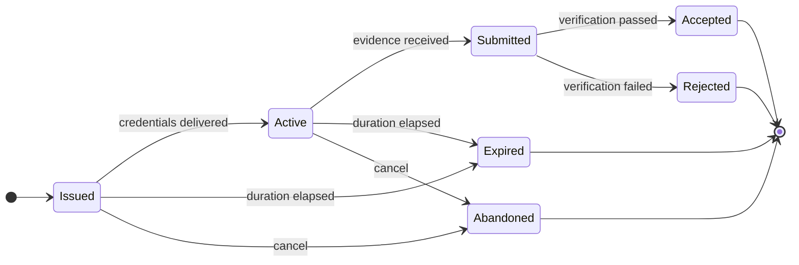

# Browser game catalog and session contract

## Public configuration

`GET /api/v1/games` and `GET /api/v1/games/:gameId` expose only an active game whose `active_version_id` identifies a published version with a publication timestamp. The response includes immutable version/rules metadata, the server duration cap, and active cosmetic characters. Draft and retired records use the same absence behavior as unknown records.

Public catalog responses use `Cache-Control: public, max-age=60, stale-while-revalidate=30`. A client may render cached discovery data, but session creation always reselects and locks the current active published version from the database. The session response is therefore authoritative if a catalog cache becomes briefly stale.

## Browser creation flow

An active verified player creates a session with `POST /api/v1/games/:gameId/sessions`. Cookie authentication, the signed session-bound CSRF header, and the dedicated issuance limiter are mandatory. The strict request body is exactly:

```json
{ "mode": "practice" }
```

or:

```json
{ "mode": "ranked" }
```

The server selects the version and supplies the public session UUID, UTC `startedAt`, bounded `expiresAt`, mode, initial `active` state, immutable rules, and two independently random 256-bit base64url credentials:

- `seed`: initializes the deterministic browser/server rules module;
- `nonce`: binds the future M06 evidence submission to this issued session.

The browser must retain seed and nonce only for the current run. They are delivered once in the `201` response under `data.credentials`; `GET /api/v1/game-sessions/:sessionId` never returns them. Both session routes use `Cache-Control: no-store`. Persistence contains only SHA-256 hashes, and structured logging redacts raw and hash field names.

Do not derive a score, XP award, completion time, owner, version, or status from browser claims. M06 accepts only strict `runner-evidence-v1` at `POST /api/v1/game-sessions/:sessionId/scores`, binds it to this session's credentials/version, and replays it through the injected deterministic verifier. See `docs/score-verification.md`.

## Ownership, duplicates, and expiry

- Retrieval is scoped by the authenticated player's public UUID. An unknown session and another player's session both return `404 GAME_SESSION_NOT_FOUND`.
- A player may have one open session per game and mode. Open means `issued`, `active`, or `submitted`. Practice and ranked sessions do not block each other.
- Creation locks the active user row, expires stale issued/active rows, checks for an open duplicate, and inserts the new session in one transaction. Concurrent same-mode requests therefore yield one creation and conflicts for the rest.
- A duplicate returns `409 GAME_SESSION_ALREADY_ACTIVE`; one-time credentials are never replayed.
- At `expiresAt` or later, an owned issued/active session is atomically transitioned to `expired` and returned with `200`. A later create request may then issue a replacement.
- The dedicated process-local issuance limit defaults to 10 requests per 60 seconds. A shared limiter store is still required before horizontal deployment.

## Session state machine



M05 performs `issued -> active` inside the creation transaction, so browsers observe `active`. Automatic expiry uses server UTC. M06 performs `active -> submitted -> accepted|rejected` in one locked transaction. Structurally valid verification failures are terminal; malformed requests persist nothing. Infrastructure failures roll back to `active`, permitting an identical idempotent retry. Practice score submission is rejected without a lifecycle or reward effect. Terminal states do not transition.

## Phaser integration checklist

1. Fetch game detail and load the client module matching `version.id` and `rulesVersion`.
2. Create a practice or ranked session immediately before starting simulation.
3. Treat response `startedAt`/`expiresAt` as authoritative; never send browser wall-clock start or finish time.
4. Initialize deterministic simulation from `credentials.seed`; keep seed and nonce out of logs, URLs, analytics, and durable browser storage.
5. Stop accepting gameplay input when the server expiry has elapsed. M06 requires receipt while the session is unexpired and derives finish time from deterministic ticks.
6. If credentials are lost, do not request their retrieval; the browser must wait for expiry or use a future approved abandon operation.
7. Submit strict `runner-evidence-v1` once with `Idempotency-Key`; an identical retry returns the original result.
8. Do not show a ranked/XP result until the verification response accepts it.
